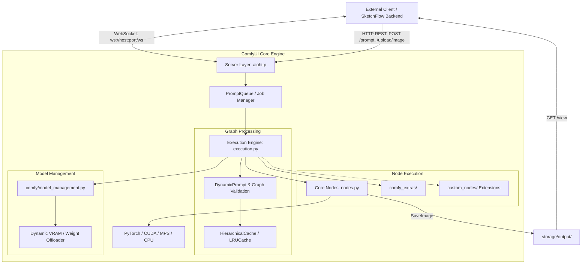
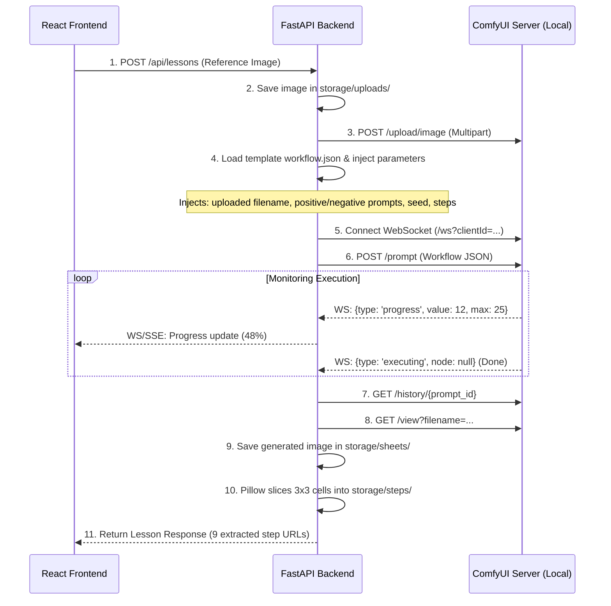

# Research Analysis: ComfyUI Core Technical Deep Dive

**Stage**: Stage 2 — Image Generation Engine Technical Research  
**Target Repository**: [ComfyUI (Comfy-Org/ComfyUI)](https://github.com/Comfy-Org/ComfyUI.git)  
**Research Date**: November 2026  
**Document Path**: `docs/research/comfyui_core_analysis.md`  

---

## 1. Overview

ComfyUI is a modular, graph-based execution engine and graphical user interface designed primarily for generative diffusion models (Stable Diffusion 1.5, SD2, SDXL, SD3, FLUX, Stable Cascade, and newer video/multimodal architectures like Wan and Cosmos). 

Unlike monolithic generation applications (e.g. AUTOMATIC1111 WebUI), ComfyUI breaks down generative AI into atomic functional components represented as nodes in a Directed Acyclic Graph (DAG). It features an integrated asynchronous HTTP and WebSocket server, sophisticated GPU/CPU memory and VRAM management (`model_management.py`), execution caching (`execution.py`), and a headless API mode designed for programmatically orchestrating image generation.

For **SketchFlow AI**, ComfyUI represents a potential local or self-hosted backend generation engine capable of executing custom image-to-image, ControlNet, and prompt-conditioned workflows without vendor lock-in.

---

## 2. Verified Architecture

ComfyUI is implemented in Python and structured into distinct layers:



### Architectural Pillars:
1. **Asynchronous Web & WebSocket Server (`server.py`)**: Built on `aiohttp.web`. Exposes REST endpoints for job dispatch, asset uploads, file streaming, and a duplex WebSocket channel for real-time node progress, execution telemetry, and latent previews.
2. **DAG Execution & Caching Engine (`execution.py`)**: Validates the node connection graph, detects cycles, calculates an execution order using topological sorting, and employs hierarchical cache fingerprinting (`HierarchicalCache`, `LRUCache`) to prevent re-executing unchanged nodes (e.g. model loading or CLIP encoding).
3. **Dynamic Memory & VRAM Management (`comfy/model_management.py`)**: Dynamically monitors GPU VRAM pressure via NVML/CUDA, automatically swaps models between system RAM and GPU VRAM on-the-fly, and supports execution on constrained hardware (low-VRAM, CPU fallback, FP8 quantization).
4. **Node Registry (`nodes.py`, `comfy_extras/`)**: Standardized Python classes defining inputs, outputs, and execution methods for checkpoints, samplers, VAEs, conditioning, ControlNet, and latent operations.

---

## 3. How Node Workflows Operate

In ComfyUI, a "workflow" is a Directed Acyclic Graph (DAG) where nodes represent data sources, transformations, or sinks:
- **What Nodes Are**: A Python class defining an `INPUT_TYPES()` classmethod (returning required and optional inputs with types and constraints), a `RETURN_TYPES` tuple (specifying output data types), a `FUNCTION` string (naming the execution method), and a `CATEGORY`.
- **How Nodes Connect**: Node outputs connect to downstream node inputs. Connections are strictly typed (e.g., `MODEL`, `CLIP`, `VAE`, `CONDITIONING`, `LATENT`, `IMAGE`, `MASK`).
- **Graph Serialization**: ComfyUI represents an executable workflow in a clean API JSON dictionary:
  ```json
  {
    "3": {
      "class_type": "KSampler",
      "inputs": {
        "cfg": 8,
        "denoise": 1,
        "latent_image": ["5", 0],
        "model": ["4", 0],
        "positive": ["6", 0],
        "negative": ["7", 0],
        "sampler_name": "euler",
        "scheduler": "normal",
        "seed": 8566257,
        "steps": 20
      }
    }
  }
  ```
  In this format, `["5", 0]` means "take output index 0 from node ID '5'".
- **How Workflows Are Executed**:
  1. The client sends the prompt JSON to `POST /prompt`.
  2. The server assigns a unique `prompt_id` and adds it to `PromptQueue`.
  3. `execution.py` validates inputs and builds an execution tree starting from outputs (nodes with `OUTPUT_NODE = True`, e.g., `SaveImage`).
  4. It evaluates upstream dependencies recursively.
  5. Intermediate outputs are cached; if inputs match a previously executed signature, the node execution is skipped and cached tensors are reused.
- **Output Storage & History**:
  - Generated images are saved to the filesystem under `output/` (configured in `folder_paths.py`).
  - Output metadata (filename, subfolder, type) is logged to the server's in-memory history dictionary (`self.history[prompt_id]`), retrievable via `GET /history/{prompt_id}`.

---

## 4. Image Generation Pipeline

### A. Core Elements of Text-to-Image (T2I)
1. **CheckpointLoaderSimple (`nodes.py`)**: Loads the neural network weights from a `.safetensors` file into memory. Outputs:
   - `MODEL`: The diffusion backbone (U-Net or Diffusion Transformer / DiT).
   - `CLIP`: The text encoder (CLIP ViT-L, OpenCLIP, T5-XXL depending on model).
   - `VAE`: The Variational Autoencoder.
2. **CLIPTextEncode (`nodes.py`)**: Converts raw string prompts into embedding tensor conditioning vectors (`CONDITIONING`).
   - *Positive Prompt*: Directs the model toward desired subjects, art styles, line weights.
   - *Negative Prompt*: Directs the model away from unwanted artifacts, colors, or styles.
3. **EmptyLatentImage (`nodes.py`)**: Allocates an empty 4-channel tensor of shape `[batch_size, 4, height // 8, width // 8]` filled with zeros in latent space.
4. **KSampler / KSamplerAdvanced (`nodes.py`)**: The iterative denoising core.
   - *Sampling Steps*: Number of iterations (typically 20–30) the noise predictor runs.
   - *CFG (Classifier-Free Guidance)*: Scalar (e.g. 7.0–8.0) determining how strictly the generation adheres to the positive prompt relative to the unconditional negative prompt.
   - *Seed*: Integer establishing pseudorandom initial Gaussian noise; identical seeds with identical parameters guarantee deterministic results.
   - *Sampler & Scheduler*: Numerical algorithms for step updates (e.g. `euler`, `dpmpp_2m`, `heun`) and noise step schedules (`normal`, `karras`, `exponential`).
5. **VAEDecode (`nodes.py`)**: Takes the final denoised latent tensor and translates it through the VAE decoder into pixel space `[B, H, W, C]` with float values in `[0, 1]`.
6. **SaveImage (`nodes.py`)**: Converts torch tensors to PIL Images and saves them as PNG files with prompt metadata embedded in the PNG headers (`extra_pnginfo`).

### B. Image-to-Image (Img2Img) Pipeline
Instead of `EmptyLatentImage`, an existing image is provided:
1. **LoadImage (`nodes.py`)**: Loads an image from the `input/` folder and normalizes it to a PyTorch tensor.
2. **VAEEncode (`nodes.py`)**: Compresses the pixel image into a latent tensor using the VAE encoder.
3. **KSampler with `denoise < 1.0`**:
   - `denoise = 1.0` replaces all latents with fresh Gaussian noise (identical to text-to-image).
   - `denoise = 0.5` retains 50% of the original latent structure and injects 50% noise, allowing the model to redraw lines, refine shapes, or alter style while maintaining overall composition.

---

## 5. Reference Image Control

For **SketchFlow AI**, preserving the user's reference drawing across tutorial steps is paramount. ComfyUI provides multiple conditioning mechanisms:

| Technology | What It Does | How It Operates | Value for Drawing Tutorials | prototype Necessity |
| :--- | :--- | :--- | :--- | :--- |
| **Image-to-Image (Img2Img)** | Modifies existing pixel drawing with noise control. | Encodes image to latents with VAE; denoises at fractional step (`denoise 0.3–0.7`). | High: Great for refining rough sketches into clean outlines. | **Essential** |
| **ControlNet (Canny / Lineart)** | Forces diffusion to follow exact spatial structural edges. | Passes extracted line edges into specialized ControlNet model weights, steering U-Net attention blocks. | **Critical**: Forces the AI to preserve exact proportions and contours of the user's upload. | **High Priority** |
| **ControlNet (Depth)** | Preserves 3D depth and volume layout. | Uses depth maps (MiDaS / DepthAnything) to condition spatial depth. | Moderate: Helpful for 3D forms/perspective, less necessary for simple 2D line sketches. | Low (Investigate Later) |
| **ControlNet (OpenPose)** | Preserves human/animal skeletal poses. | Detects keypoints (joints, limbs) and forces generation to match the posture. | High for character/figure drawing; irrelevant for objects/still life. | Medium |
| **Inpainting & Masking** | Redraws only a designated bounding box or mask region. | `VAEEncodeForInpaint` or `SetLatentNoiseMask` injects noise only within the mask while locking surrounding pixels. | **Critical**: Ideal for surgical user corrections on specific steps without rerunning the entire sheet. | **High Priority** |
| **IP-Adapter** | Image-based prompt conditioning. | Uses CLIP Vision embeddings fed into decoupled cross-attention layers to transfer character/object identity. | High: Preserves character identity without retraining. | Medium (Requires Custom Node) |
| **LoRA (Low-Rank Adaptation)** | Adapts model weights for a specific style. | Modifies cross-attention weights to enforce drawing styles (e.g. "pencil sketch", "step-by-step tutorial"). | **High**: Excellent for enforcing a consistent black-and-white minimalist line art aesthetic. | **High Priority** |
| **StyleModel (`nodes.py`)** | Core alternative to style IP-Adapter. | Built-in ComfyUI node using CLIP Vision to extract visual style conditioning. | Moderate: Core-native but less controllable than dedicated Lineart ControlNets. | Medium |

---

## 6. ComfyUI API and External Application Integration

ComfyUI provides a complete headless API that allows our FastAPI backend to control it over a local network or loopback socket (`127.0.0.1:8188`).

### A. Communication Architecture
```
[User Browser (React)]
       |
  (HTTP / WS)
       v
[SketchFlow Backend (FastAPI)]  <-- Orchestrates, validates, authenticates
       |
  (Local HTTP / WS Client)
       v
[ComfyUI Core Server (127.0.0.1:8188)]  <-- Headless worker engine
```

### B. Verified API Endpoints (`server.py` & `openapi.yaml`)
1. **`POST /upload/image`**: Uploads user reference images directly into ComfyUI's `input/` folder via multipart form data (`image`, `subfolder`, `overwrite`). Returns JSON containing the saved filename.
2. **`POST /prompt`**: Dispatches the workflow execution graph.
   - Body: `{"prompt": <workflow_json>, "client_id": "<uuid>"}`
   - Returns: `{"prompt_id": "<uuid>", "number": 1, "node_errors": {}}`
3. **`GET /ws?clientId=<uuid>`**: Duplex WebSocket connection providing real-time telemetry:
   - `status`: Server queue status and memory stats.
   - `execution_start`: Indicates prompt execution has commenced.
   - `executing`: Payload includes `node` (node ID currently running). When `node` is `null`, execution is complete.
   - `progress`: Current sampling step and total steps (`value`, `max`).
   - `execution_error`: Real-time node exceptions and stack traces.
4. **`GET /history/{prompt_id}`**: Retrieves completed output metadata, node outputs, and generated file references.
5. **`GET /view?filename=...&subfolder=...&type=output`**: Fetches the generated binary image bytes.
6. **`POST /interrupt`**: Immediately halts the currently running execution.
7. **`POST /queue`**: Allows clearing or deleting pending queue tasks.
8. **`POST /free`**: Unloads loaded models from VRAM on demand.

---

## 7. Workflow Automation

To ensure users never see or interact with ComfyUI nodes, our FastAPI backend will encapsulate workflow execution:



### Responsibility Separation
- **Inside ComfyUI**: Model weight loading, GPU tensor arithmetic, latent sampling, ControlNet guidance, VAE decoding.
- **Inside FastAPI**: Authentication, rate-limiting, prompt construction, dynamic template parameter injection, WebSocket monitoring, downloading output binaries, slicing 3×3 grids via Pillow, and persisting metadata to SQLite.

---

## 8. Custom Nodes and Extensions

### What They Are & How They Work:
- Custom nodes are external Python scripts or modules placed in the `custom_nodes/` directory.
- `nodes.py:load_custom_node()` dynamically imports every module in `custom_nodes/` and registers any classes exported in `NODE_CLASS_MAPPINGS`.
- They allow third parties to add custom preprocessors (e.g., ControlNet lineart extractors, DepthAnything), external model loaders, complex math nodes, and UI helpers.

### Risks and Trade-offs for SketchFlow AI:
1. **Arbitrary Code Execution**: Custom nodes execute Python code on startup without sandboxing.
2. **Dependency Conflicts**: Many custom nodes pin conflicting versions of `torch`, `torchvision`, `diffusers`, or `transformers`, leading to pip dependency collisions.
3. **Fragility & Breaking Changes**: When ComfyUI Core updates internal APIs (e.g. execution engine refactors, `comfy_execution`), unmaintained custom nodes frequently crash the entire server.
4. **Maintenance Overhead**: Packaging custom nodes into a standalone distribution requires complex multi-git dependency synchronization.

### Strategic Recommendation for SketchFlow AI:
- **Avoid Third-Party Custom Nodes for Prototype**: ComfyUI Core already contains `ControlNetLoader`, `ControlNetApply`, `VAEEncodeForInpaint`, `CLIPTextEncode`, and `SaveImage`.
- **Implement Custom Logic in FastAPI with Pillow**: Preprocessing (e.g. Canny edge detection, aspect-ratio cropping, 3×3 grid slicing) should be done in our FastAPI backend using standard libraries rather than relying on ComfyUI custom node packages.

---

## 9. Model Support and Hardware

### Supported Architectures in Current ComfyUI Core:
- **Stable Diffusion 1.5 & 2.1**: Full support (512×512 baseline, lowest VRAM, fast).
- **SDXL (Stable Diffusion XL)**: Full support (1024×1024 baseline, dual CLIP encoders, high detail).
- **SD3 / SD3.5**: Full support via `comfy_extras/nodes_sd3.py`.
- **FLUX (Flux.1-schnell / Flux.1-dev)**: Full support via `comfy_extras/nodes_flux.py` (flow matching, DiT architecture, superior prompt following, high VRAM).
- **Checkpoints & Formats**: `.safetensors` (standard and recommended for security), `.ckpt` (legacy pickled weights, unsafe).

### Hardware & VRAM Management (`comfy/model_management.py`):
- **Dynamic VRAM Offloading**: Models are loaded into system RAM and transferred to GPU VRAM only when required for execution, then offloaded to make room for VAE or text encoders.
- **CLI Hardware Flags**:
  - `--lowvram` / `--novram`: Aggressively splits and moves model layers between RAM and GPU. Enables execution on 4GB–6GB GPUs.
  - `--cpu`: Executes purely on system CPU (slow, but works without a dedicated GPU).
  - `--cpu-vae`: Keeps the heavy VAE decode step on CPU to prevent out-of-memory spikes at the final step.
  - `--fp8_e4m3fn-unet` / `--fp8_e5m2-unet`: Uses 8-bit floating point weights for the diffusion model, cutting VRAM requirements in half (crucial for running SDXL or FLUX on 8GB VRAM).

---

## 10. Relevance to Our 3 × 3 Drawing-Sheet Idea

SketchFlow AI proposes generating an entire 9-step tutorial in a single 3×3 grid sheet. How does ComfyUI support this?

### Verified Capabilities:
1. **Strict Composition Control via ControlNet**: If we provide an empty 3×3 grid template image (lines separating 9 cells) to a ControlNet Canny or Lineart model, ComfyUI can force the diffusion model to respect the 9-box boundary.
2. **Latent Grid / Regional Conditioning**: ComfyUI Core has `ConditioningSetAreaPercentage` and `ConditioningSetMask` in `nodes.py`. This theoretically allows attaching distinct text prompts (e.g. "Step 1: rough circle" vs "Step 9: detailed shaded cat") to specific spatial areas (cells) of a single canvas!
3. **Deterministic Seed Reproducibility**: Locking the seed guarantees exact reproducibility when testing prompt iterations.

### Model vs. Engine Distinctions:
- **ComfyUI is an Execution Engine, NOT the Generative Brain**: ComfyUI will route latents, samplers, and ControlNets flawlessly, but **the underlying model** (SD 1.5, SDXL, or FLUX) determines whether 9 sequential steps can logically progress from basic shapes to completed drawings.
- Standard general diffusion models are not trained specifically on 9-step educational drawing sheets. They may generate 9 variations of a finished object rather than a true educational progression unless conditioned heavily via:
  - Strong prompt templates specifying a sequential sheet.
  - A specialized drawing sheet LoRA.
  - Regional area conditioning dividing the canvas into 9 sub-prompts.
  - Or multi-pass image-to-image chaining.

---

## 11. Important Repository Files

| Exact Path | Purpose | Key Contents | Architectural Significance | Value for SketchFlow AI |
| :--- | :--- | :--- | :--- | :--- |
| `server.py` | Web & WebSocket server | Routes (`/prompt`, `/history`, `/view`, `/upload/image`), WS handler, CORS, job management | The primary interface our FastAPI backend will interact with. | **Critical**: Defines the exact endpoints, request formats, and socket events. |
| `execution.py` | Graph execution & caching | `DynamicPrompt`, `HierarchicalCache`, `LRUCache`, cycle detection, execution loop | Controls topological sorting, node caching, and execution dispatch. | **High**: Teaches how caching works (why repeated prompts with same seed skip model loading). |
| `nodes.py` | Core node definitions | `CheckpointLoaderSimple`, `KSampler`, `CLIPTextEncode`, `VAEDecode`, `ControlNetApply`, `SaveImage` | Contains all fundamental building block classes for building workflows. | **Critical**: Reference for constructing API prompt JSON graphs. |
| `comfy/model_management.py` | Memory & VRAM manager | `VRAMState`, dynamic offload, CUDA memory tracking, FP8 quantization | Handles GPU resource allocation and prevents Out-Of-Memory (OOM) crashes. | **High**: Informs our backend how to launch ComfyUI with optimal VRAM flags. |
| `script_examples/websockets_api_example.py` | Reference client integration | Clean Python script demonstrating prompt submission, WS polling, and image fetching | Working proof-of-concept for how an external Python client communicates with ComfyUI. | **Critical**: Blueprint for our FastAPI ComfyUI client service. |
| `comfy/cli_args.py` | Startup CLI options | Argument parsing (`--listen`, `--port`, `--lowvram`, `--cpu-vae`, `--enable-cors-header`) | Defines how to run ComfyUI safely as a headless subprocess. | **High**: Configuration guide for local engine startup. |

---

## 12. Security and Reliability

### Verified Security Concerns:
1. **No Built-in Authentication**: ComfyUI's API has no authentication by default. Anyone with network access to the port can queue jobs, read files, or trigger arbitrary node executions.
2. **Arbitrary Python in Custom Nodes**: Installing untrusted custom nodes can compromise the host machine.
3. **Pickle Vulnerabilities in Legacy Checkpoints**: Loading `.ckpt` files can trigger arbitrary code execution (mitigated by exclusively using `.safetensors`).
4. **File Overwrite Risks**: File upload endpoints must be carefully scoped to avoid overwriting host files.

### Reliability & Resilience:
- **Queue Interruption**: Calling `POST /interrupt` halts a hanging or runaway generation without killing the server process.
- **Timeouts**: If ComfyUI crashes due to CUDA OOM, the process terminates. A watchdog or process supervisor in FastAPI is required to auto-restart the instance.

### Recommended Security Architecture for SketchFlow AI:
- **Loopback Only**: Bind ComfyUI strictly to `127.0.0.1:8188` (default). Never expose port 8188 to the public internet or local network.
- **FastAPI Reverse Proxy**: All user requests go to FastAPI (`http://127.0.0.1:8000`). FastAPI validates requests, sanitizes prompts, and calls ComfyUI internally over loopback.
- **Strict `.safetensors` Only**: Never allow `.ckpt` or untrusted model files.
- **Run Headless with Auto-Launch Disabled**: Use flags `--disable-auto-launch --listen 127.0.0.1 --port 8188`.

---

## 13. ComfyUI vs. SketchFlow AI Responsibilities

```
+-------------------------------------------------------------------------+
|                       SKETCHFLOW AI (FastAPI + React)                   |
|                                                                         |
|  - User Interface & Tutorial Walkthroughs                               |
|  - User Authentication, Lessons, Progress & History (SQLite)            |
|  - Reference Image Upload & Preprocessing (Validation, Pillow Resize)   |
|  - Pedagogical Planning (Basic shapes -> Outline -> Details -> Shading) |
|  - Prompt Formulation & Workflow Parameter Injection                    |
|  - Job Queue Management & User Progress Feedback                        |
|  - 3x3 Grid Slicing & Extraction into Individual Step Images (Pillow)    |
|  - Exporting Lessons to PDF / Zip / Worksheets                          |
|  - Localized User Feedback & Targeted Corrections                       |
+-------------------------------------------------------------------------+
                                    |
                           HTTP / WebSocket (JSON)
                                    v
+-------------------------------------------------------------------------+
|                         COMFYUI ENGINE (Headless Worker)                |
|                                                                         |
|  - Checkpoint & LoRA Model Weight Loading into GPU / RAM                |
|  - Text Prompt Tokenization & CLIP Embeddings                           |
|  - ControlNet Spatial Guidance (Lineart / Edge Conditioning)            |
|  - Latent Noise Sampling (KSampler Iterations)                          |
|  - VAE Encoding & Decoding (Latent <-> Pixels)                          |
|  - Dynamic VRAM Memory Swapping & Offloading                            |
|  - Raw Image File Generation & Rendering                                |
+-------------------------------------------------------------------------+
```

---

## 14. Useful Capabilities for SketchFlow AI

1. **Headless REST + WebSocket Control**: Clean, decoupled integration via standard Python HTTP and WebSocket clients.
2. **Graph Caching**: Fast iteration; modifying only the prompt or seed reuses loaded checkpoint weights in VRAM without reloading models from disk.
3. **Native ControlNet Support**: Can guide generations using structural line art from the user's reference image without external plugins.
4. **Hardware Flexibility**: Dynamic offloading and FP8 support allow running diffusion models on consumer laptop GPUs.
5. **Deterministic Seeds**: Enables exact reproducibility during prompt engineering and workflow testing.

---

## 15. Limitations for SketchFlow AI

1. **No Inherent Pedagogical Intelligence**: ComfyUI is an image generator, not an art teacher. It cannot analyze whether a drawing step is "easy for a beginner" or construct an 8-stage lesson plan on its own.
2. **Local GPU Requirement**: Running diffusion models locally requires significant VRAM (minimum 6GB–8GB for decent performance; 12GB+ for large models).
3. **Cold Start Time**: Launching ComfyUI and loading a 4GB–12GB model checkpoint takes 15–45 seconds before the first image can be generated.
4. **Grid Quality Uncertainty**: Standard diffusion models may struggle to produce 9 clean, non-bleeding, perfectly aligned cells without specialized fine-tuning or regional conditioning.

---

## 16. What We Can Reuse Conceptually

- **Decoupled Engine Pattern**: Treating generation as an isolated stateless worker service rather than embedding ML models directly in the web API.
- **Prompt Execution Graph**: The concept of defining an image generation job as a declarative JSON dictionary with explicit data inputs and outputs.
- **Dynamic Offloading Principles**: Loading heavy assets on demand and releasing VRAM when idle.

---

## 17. What We Should Implement Ourselves

1. **Curriculum & Lesson Planner**: LLM-based step breakdown and prompt generator (in FastAPI).
2. **Image Slicing & Cell Extraction**: Dedicated Python Pillow module for splitting the 3×3 grid into individual PNG steps.
3. **FastAPI ComfyUI Client**: An asynchronous client (`ComfyClient`) in `backend/app/services/` that submits workflows and handles WebSocket progress.
4. **Database & Storage Management**: SQLite models for tracking lessons, steps, and user progress.

---

## 18. What We Do Not Need

- **ComfyUI Frontend / WebUI**: We do not need the node editor interface (`litegraph.js` / Vue UI). Users should only see SketchFlow AI's interface.
- **Heavy Third-Party Custom Node Packs**: No need for ComfyUI-Manager or sprawling extension packs for our initial prototype.
- **Audio, Video, 3D Nodes**: Exclude video and 3D generation modules (`nodes_video.py`, `mesh3d`, etc.).

---

## 19. Sources and Links to Examined Files

The following files from `Comfy-Org/ComfyUI` were cloned into a temporary research workspace and verified line-by-line:

- **Server & API Layer**:
  - `server.py`: Lines 1–180, 400–600 (Verified REST routes `/prompt`, `/history`, `/view`, `/upload/image`, and WebSocket `/ws`).
  - `openapi.yaml`: Lines 1074–1100, 3800–3860 (Verified OpenAPI schemas for `PromptRequest`, `PromptResponse`, and error status codes).
  - `script_examples/basic_api_example.py`: Lines 1–100 (Verified baseline prompt queue submission).
  - `script_examples/websockets_api_example.py`: Lines 1–120 (Verified WebSocket telemetry monitoring and history retrieval).
- **Execution & Graph Processing**:
  - `execution.py`: Lines 1–150 (Verified `HierarchicalCache`, `DynamicPrompt`, input fingerprinting, and execution order).
- **Core Nodes & Models**:
  - `nodes.py`: Lines 875–966 (Verified `ControlNetLoader`, `ControlNetApply`, `ControlNetApplyAdvanced`, `KSampler`, `VAEDecode`).
  - `comfy/model_management.py`: Lines 1–100 (Verified `VRAMState`, dynamic offloading, FP8 precision support).
  - `comfy/cli_args.py`: Lines 1–100 (Verified CLI arguments: `--listen`, `--port`, `--lowvram`, `--cpu-vae`, `--enable-cors-header`).
