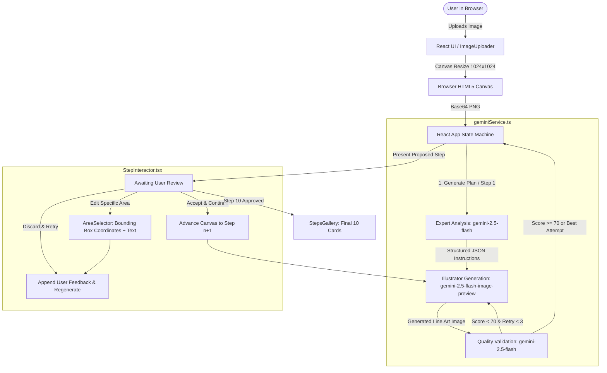

# Research Analysis: DrawEasy Repository

**Stage**: Stage 1 — Technical Repository Analysis  
**Target Repository**: [DrawEasy (Francesco-Granozio/DrawEasy)](https://github.com/Francesco-Granozio/DrawEasy.git)  
**Research Date**: November 2026  
**Document Path**: `docs/research/draw_easy_analysis.md`  

---

## 1. Repository Overview

DrawEasy is a client-side proof-of-concept web application designed to transform any drawing into an interactive 10-step drawing tutorial. It allows a user to upload a reference sketch, and then uses Google Gemini models to orchestrate a three-role workflow:
1. An **AI Drawing Instructor** that creates progressive drawing instructions and evaluates generated steps.
2. An **AI Illustrator** that executes the instructions into progressive black-and-white line art.
3. An **Interactive User-in-the-Loop Reviewer** that allows the human learner to accept steps, retry with global textual feedback, or select a bounding box to request focused corrections.

The repository is compact, containing approximately 12 source files with no dedicated backend server or persistence layer.

---

## 2. Verified Technology Stack

| Layer | Technology | Version / Spec | Verification Source |
| :--- | :--- | :--- | :--- |
| **Frontend Framework** | React | `19.1.1` | `package.json` |
| **Language** | TypeScript | `~5.8.2` | `package.json`, `tsconfig.json` |
| **Styling** | Tailwind CSS | Utility classes | `index.css`, `App.tsx` |
| **Build Tool** | Vite | `7.1.7` / `@vitejs/plugin-react 5.0.4` | `package.json`, `vite.config.ts` |
| **AI SDK** | `@google/genai` | `^1.21.0` | `package.json`, `services/geminiService.ts` |
| **Vision & Reasoning Model** | Google Gemini 2.5 Flash (`gemini-2.5-flash`) | Multimodal LLM with JSON schema output | `services/geminiService.ts` |
| **Image Generation Model** | Google Gemini 2.5 Flash Image Preview (`gemini-2.5-flash-image-preview`) | Multimodal generation with `Modality.IMAGE` | `services/geminiService.ts` |
| **Backend Server** | *None* | Client-only architecture | Entire repository inspection |
| **Database / Storage** | *None* | React in-memory state (`useState`) | `App.tsx` |
| **Image Processing** | HTML5 Canvas API | Browser client canvas resizing | `App.tsx` (`resizeImage`) |

---

## 3. Actual Architecture

DrawEasy is structured entirely as a single-page client application. All API calls to Google's Gemini models are issued directly from the user's browser using Google's GenAI JavaScript SDK.



### Component Communication
1. **`App.tsx`**: State coordinator managing the finite state machine (`IDLE` → `LOADING` → `AWAITING_USER_INPUT` → `RESULTS` / `ERROR`).
2. **`components/ImageUploader.tsx`**: Drag-and-drop or file picker that passes a raw `File` to `App.tsx`.
3. **`App.tsx:resizeImage`**: Downscales the image via HTML5 Canvas to a maximum of 1024×1024 on a white canvas and produces a base64 PNG string.
4. **`services/geminiService.ts`**: Pure async functions that communicate directly with Google's Gemini endpoint via the `@google/genai` client.
5. **`components/StepInteractor.tsx` & `AreaSelector.tsx`**: Handles human feedback before advancing to the next step.
6. **`components/StepsGallery.tsx`**: Displays the final 10 approved steps in a grid layout.

---

## 4. End-to-End Workflow

1. **Upload**: User drops a PNG, JPEG, or WEBP image.
2. **Preprocessing**: The browser resizes the image to fit 1024×1024 on a white canvas to normalize resolution and MIME type (`image/png`).
3. **First Step Planning**: `generateFirstStepInstructions()` sends the reference image to `gemini-2.5-flash` with a strict JSON schema prompt instructing the model to generate the first, simplest foundation step (target completeness: 10%).
4. **Generation & Quality Control Loop**:
   - `generateValidatedStep()` sends the reference image, the previous canvas (null on step 1), and textual instructions to `gemini-2.5-flash-image-preview`.
   - The generated image is returned as base64 line art.
   - Immediately, `expertValidateImage()` sends the generated image, the reference image, and the previous canvas back to `gemini-2.5-flash`.
   - The model assigns a score (0–100), lists issues, and outputs a recommendation (`proceed` or `regenerate`).
   - If the score is below 70, the application retries generation up to 3 times, appending `EXPERT CORRECTION: <feedback>` to the instructions.
   - If 3 retries are exhausted, the attempt with the highest score is picked.
5. **Human Review**:
   - The app transitions to `AWAITING_USER_INPUT`.
   - The user inspects the proposed image and sees the expert instructions and score (e.g., `85/100`).
   - The user chooses:
     - **Accept & Continue**: Commits the step to `acceptedSteps`, updates `currentCanvas` with this step's image, and begins the next step.
     - **Discard & Retry**: User types general feedback, which is appended to the instructions for a new generation cycle.
     - **Edit Specific Area**: User drags a box over a region of the drawing and enters text feedback targeted to those coordinates.
6. **Completion**:
   - Once Step 10 is approved, `appState` shifts to `RESULTS`, rendering `StepsGallery.tsx` with all 10 cards.

---

## 5. Image Analysis

### How DrawEasy Understands the Subject:
- **No Traditional Preprocessing**: No OpenCV edge extraction, no segmentation, and no contour detection.
- **Multimodal AI**: It feeds the base64-encoded image directly into `gemini-2.5-flash`.
- **Information Extracted**: The model is prompted to identify:
  - The simplest foundational elements (e.g., loose rectangle for a house body, oval for a face).
  - What a student should draw in a 10-second rough gesture sketch.
  - Proportions, orientation, and primary shapes.
- **Limitations**: DrawEasy **does not** compute a difficulty rating, complexity score, or adaptive step count. It assumes all subjects can and must be drawn in exactly 10 steps.

---

## 6. Drawing-Plan Generation

- **Fixed Step Count**: The tutorial length is fixed at `totalSteps = 10`.
- **Dynamic Step-by-Step Chaining (Not Pre-Generated)**:
  - DrawEasy **does not** generate steps 1 through 10 upfront in a static master plan.
  - Step 1 instructions are created upon initial upload.
  - Instructions for Step $n+1$ are dynamically returned during the validation of Step $n$ via the `instructionsForNextStep` property in `ExpertValidation`.
  - The model calculates target completeness dynamically: `target = Math.round((stepNumber / totalSteps) * 100)%`.
- **Structured Schema**:
  ```json
  {
    "stepNumber": 1,
    "totalSteps": 10,
    "targetCompleteness": 10,
    "whatToDraw": "Rough oval shape for the head outline",
    "drawingInstructions": "Draw a loose, sketchy oval...",
    "avoidance": "NO facial features, NO hair, NO details"
  }
  ```

---

## 7. Drawing-Stage Generation

- **Sequential Image-to-Image Generation**:
  - Generation is **not** independent.
  - Every step (after step 1) explicitly sends the previous canvas (`previousCanvas.base64`) along with the original reference image (`originalImage.base64`) to the generator.
- **Model**: `gemini-2.5-flash-image-preview` using multimodal generation (`responseModalities: [Modality.IMAGE, Modality.TEXT]`).
- **Prompt Guardrails**:
  - Forced black-and-white line art on white background.
  - Explicit prohibition of text or labels.
  - Step 1 rules enforce loose, rough gesture sketching.
  - Later steps instruct gradual refinement without jumping ahead.

---

## 8. Step Progression

- Progression is chained: Step $n$ is visually anchored to Step $n-1$.
- In `App.tsx:handleAcceptStep`:
  ```typescript
  const [, imageData] = proposedStep.imageUrl.split(';base64,');
  const mimeType = proposedStep.imageUrl.substring(5, proposedStep.imageUrl.indexOf(';'));
  const newCanvas = { base64: imageData, mimeType };
  setCurrentCanvas(newCanvas);
  ```
- This `newCanvas` is passed as `previousCanvas` into `generateValidatedStep` for Step $n+1$.
- The generator receives:
  `[previousCanvas, originalImage, promptWithInstructions]`
- This visual continuity forces the AI illustrator to build incrementally upon the exact pixels of the previously approved step.

---

## 9. Validation and Quality Control

DrawEasy contains a dedicated AI-as-a-judge quality control loop:

1. **Automated Evaluator**: `expertValidateImage()` in `services/geminiService.ts`.
2. **Evaluator Inputs**:
   - Generated student work (current attempt).
   - Original reference image (ground truth goal).
   - Previous step image (to assess progression delta).
3. **Scoring Model**:
   - `70 – 100`: Approved automatically (`nextAction: "proceed"`).
   - `0 – 69`: Rejected (`nextAction: "regenerate"`).
4. **Automated Retry Loop**:
   - Up to `maxRetries = 3` attempts per step.
   - If rejected, `validation.feedbackForRegeneration` is appended to the instructions:
     `drawingInstructions: `${instructions.drawingInstructions}\n\nEXPERT CORRECTION: ${validation.feedbackForRegeneration}``
   - If all 3 attempts fail, the system picks the attempt with the highest score as a fallback.

---

## 10. User Correction and Regeneration

DrawEasy supports three explicit user intervention mechanisms:

1. **Discard & Retry**:
   - User clicks "Discard & Retry", inputs optional textual instructions (e.g., "Make the outer contour thicker").
   - Appends `\n\nUSER FEEDBACK: ${userFeedback}` to `currentInstructions` and re-runs `processStep()`.
2. **Edit Specific Area (`AreaSelector.tsx`)**:
   - User drags a rectangular box over the image.
   - Coordinates are calculated as percentage values:
     `x = ((e.clientX - rect.left) / rect.width) * 100`
     `y = ((e.clientY - rect.top) / rect.height) * 100`
   - Formulates a structured prompt:
     ```
     FOCUSED AREA CORRECTION:
     Area coordinates: x=25.0%, y=30.0%, width=15.0%, height=15.0%
     USER FEEDBACK FOR THIS AREA: Make the eye more circular
     IMPORTANT: Focus your improvements ONLY on the specified area. Keep the rest of the drawing exactly as it is.
     ```
   - **Crucial Technical Note**: This is **prompt-level simulated inpainting**. DrawEasy does not perform pixel-level canvas masking, latent inpainting, or composite blending; it relies purely on the multimodal model interpreting textual bounding coordinates.
3. **Cancellation**:
   - Uses standard browser `AbortController` to stop in-flight generation requests.

---

## 11. Important Files and Their Explanations

| Exact Path | Purpose | Key Contents | Architectural Significance | Usefulness for SketchFlow AI |
| :--- | :--- | :--- | :--- | :--- |
| `services/geminiService.ts` | AI orchestration service | `generateFirstStepInstructions`, `generateImageFromInstructions`, `expertValidateImage`, `generateValidatedStep` | Implements the complete 3-stage loop: Instructor plan → Illustrator generation → Judge validation with retry logic. | **High**: Excellent reference for prompt construction, instructional schemas, and validation criteria. |
| `types.ts` | Domain data types | `ExpertInstruction`, `ExpertValidation`, `DrawingStep`, `ImageObject`, `AppStateEnum` | Strictly typed interfaces for structured JSON generation, step metrics, and validation scores. | **High**: Well-designed schemas that can be adapted for our backend Pydantic models. |
| `App.tsx` | Main application coordinator | FSM state machine, `resizeImage` canvas utility, step acceptance & chaining handlers | Coordinates the flow between generation, awaiting human feedback, and chaining previous canvas state. | **Medium**: Demonstrates how to handle in-progress preview and chained state, though our implementation will be backend-driven. |
| `components/AreaSelector.tsx` | Region-based visual feedback | Bounding box drag-and-drop selector on HTML5 canvas | Translates mouse gestures into relative percentage coordinates for targeted feedback. | **Medium**: Concept is valuable for user corrections, but needs backend image masking for true inpainting. |
| `components/StepInteractor.tsx` | Human review control panel | Accept, retry, edit area modal, score display | UI for human-in-the-loop validation, transparently exposing the AI's internal score. | **Medium**: Useful UX design pattern for learner review. |
| `components/StepsGallery.tsx` | Final tutorial overview | Responsive grid of completed step cards | Renders the complete series of tutorial steps upon completion. | **Low**: Standard card gallery; our sheet viewer will be more specialized. |

---

## 12. Feature Extraction Table

| Feature | Exists in DrawEasy? | Implementation Approach | Value to SketchFlow AI | Priority for Us |
| :--- | :---: | :--- | :--- | :--- |
| **Image Upload & Client Resizing** | **YES** | HTML5 Canvas resize to 1024×1024 base64 PNG | High | High (implement on backend with Pillow) |
| **Step-by-Step Chained Generation** | **YES** | Chained sequential calls passing previous canvas | High (for comparison) | High (alternative to grid) |
| **3-Stage Workflow (Plan, Draw, Validate)** | **YES** | LLM planner, image generator, LLM judge | High | High |
| **Structured Output Schemas** | **YES** | Gemini JSON Schema (`Type.OBJECT`) | High | High |
| **AI-as-a-Judge Quality Validation** | **YES** | Multimodal LLM scoring 0–100 with issue lists | High | High |
| **Automatic Retry with Correction** | **YES** | Loop up to 3 retries appending judge feedback | High | Medium |
| **User Feedback on Rejection** | **YES** | Text input appended to prompt instructions | Medium | Medium |
| **Region-Specific Area Selection** | **YES** | Drag box providing % coordinates in text prompt | High concept / Low tech | High (needs true mask inpainting) |
| **3 × 3 Grid Sheet Generation** | **NO** | Only generates 1 step per call (10 individual calls) | High (our core proposal) | High |
| **Automated Cell Extraction** | **NO** | Does not extract from sheets | High | High |
| **Adaptive Step Count** | **NO** | Hardcoded to 10 steps | High | High |
| **Image Complexity Analysis** | **NO** | Assumes all images are equal complexity | Medium | Medium |
| **Persistent Storage (DB / Disk)** | **NO** | In-memory React state only (lost on refresh) | Critical | Critical |
| **Secure Backend API Proxy** | **NO** | Direct client-to-Gemini call (exposes API key) | Critical | Critical |
| **Lesson Resuming & Export** | **NO** | Not supported | Medium | Medium |

---

## 13. What We Can Learn from DrawEasy

### REUSE CONCEPTUALLY
1. **Three-Role Division**: Separating the instructor (pedagogy/planning), the illustrator (rendering), and the evaluator (quality inspection) produces significantly better educational structure than asking a single prompt to "draw step 1".
2. **Explicit Avoidance Guidance**: Prompts that specify both `whatToDraw` and `avoidance` (e.g., "Do NOT add facial features or pupils yet") prevent the image generator from rushing into final details in early stages.
3. **Completeness Percentage Target**: Defining a numerical `targetCompleteness: 10%, 25%, 50%...` anchors the progression logically across steps.
4. **Visual Progression Comparison**: Passing the *previous canvas* along with the *reference* and *current output* to the evaluator enables the judge to detect whether actual forward progress was made.
5. **Interactive Transparency**: Displaying the AI's internal confidence score (e.g., `85/100`) and the pedagogical instructions to the user creates trust and makes the learning process explicit.

### REIMPLEMENT OURSELVES
1. **Backend-Driven Orchestration**: Move all LLM and image generation calls to FastAPI rather than client-side JavaScript.
2. **True Bounding-Box Inpainting / Masking**: DrawEasy's `AreaSelector` only sends text coordinates to an LLM. For real drawing corrections, we should generate an alpha mask from the coordinates and perform masked inpainting or localized regeneration.
3. **Robust Storage & State Persistence**: Implement SQLite models and filesystem storage (`storage/uploads`, `storage/steps`, `storage/lessons`) so lessons can be saved, resumed, and exported.
4. **Adaptive Curriculum Planning**: Instead of hardcoding 10 steps, analyze the image to determine complexity and choose an appropriate step count (e.g., 6 steps for a coffee cup, 9 steps for a cartoon character, 18 steps across two sheets for a complex vehicle).

### DO NOT NEED
1. **Direct Browser API Key Exposure**: DrawEasy exposes the Gemini API key in the frontend bundle via Vite `define`. This must never be done.
2. **Monolithic In-Memory React State**: Relying on React `useState` for all generated images causes severe browser memory bloat (ten 1024×1024 base64 images held in memory) and complete loss of work upon page reload.
3. **Hardcoded 10-Step Ceiling**: Rigidly enforcing 10 steps regardless of subject matter.

### INVESTIGATE LATER
1. **Gemini Image Preview Modality vs. Stable Diffusion / FLUX / ComfyUI**: Whether Gemini's direct image-to-image API is superior to a dedicated local or hosted diffusion pipeline (which we will investigate in subsequent stages).
2. **Multi-turn Chat Session vs. Independent Context Calls**: DrawEasy makes stateless API calls passing all images each time. We should investigate whether a session-based or workflow-based pipeline reduces token overhead.

---

## 14. What We Should Implement Ourselves

1. **FastAPI Service Architecture**:
   - `ImageAnalysisService`: Determines object type, contours, and complexity.
   - `CurriculumPlanningService`: Determines whether 1 sheet (9 steps) or multiple sheets are needed.
   - `SheetGenerationService`: Executes the 3×3 grid generation.
   - `CellExtractionService`: Pillow-based automated slicing of grid cells.
2. **Database Schema (SQLite)**:
   - `lessons`: Stores lesson ID, title, reference image path, total steps, status.
   - `sheets`: Stores sheet index, image file path, generation prompt.
   - `steps`: Stores step number, cell coordinates, cropped image path, instructions, and completeness percentage.
3. **Pedagogical Progressions Tailored to Art Fundamentals**:
   - Enforce standard art stages: Basic Shapes → Proportions/Construction → Contour Lines → Feature Detailing → Final Refinement & Shading.

---

## 15. What We Do Not Need

- **Client-Side Heavy Canvas Operations**: Slicing, resizing, and image conversion should occur server-side with Pillow.
- **Unvalidated Third-Party React Icons**: Standardized SVG icons or lightweight icon libraries are sufficient.
- **Unrestricted Re-generation Loops**: An unbounded 3-retry loop on 10 steps can consume up to 40 multimodal API calls per tutorial, incurring prohibitive costs and latency without server-side rate limiting.

---

## 16. Grid-Based System Comparison (DrawEasy vs. SketchFlow AI 3×3 Grid)

| Dimension | DrawEasy (Sequential Chained Steps) | SketchFlow AI (Proposed 3×3 Grid Sheet) | Research Analysis & Trade-offs |
| :--- | :--- | :--- | :--- |
| **Subject Consistency** | **Moderate to Low**: Can suffer from visual drift as step $n$ builds on step $n-1$, causing subtle shape mutations over 10 iterations. | **High**: The model visualizes the entire progressive sequence of the same subject across 9 cells in a single holistic context. | DrawEasy attempts to fight drift by continuously passing the original reference image, but sequential img2img pipelines inherently drift. |
| **Logical Progression** | **Controlled by Judge**: Each step is validated before continuing, ensuring incremental progress. | **Generated in One Shot**: The AI must plan and illustrate the progression from cell (0,0) to cell (2,2) simultaneously. | Sequential generation allows fine-grained micro-adjustments; grid generation requires high prompt instruction adherence. |
| **Image Resolution & Quality** | **High per Step**: Each step is an independent 1024×1024 canvas. | **Moderate per Step**: A 1024×1024 sheet yields approximately 341×341 per cell (or 682×682 if generated at 2048×2048). | For beginner line art, 500–600px per cell is generally sufficient, but high-res models (or upscaling) will be needed for fine detail. |
| **Number of AI Requests** | **20 – 40+ Requests**: 1 plan + 10 images + 10 to 30 validations. | **1 – 3 Requests**: 1 planning call + 1 image generation call per sheet of 9 steps. | The grid approach is an order of magnitude more efficient in API call volume. |
| **Total Generation Latency** | **2 – 5 Minutes**: User waits 10–20 seconds for each individual step. | **15 – 30 Seconds**: Single image generation generates all 9 steps at once. | The grid approach provides a vastly superior user experience in terms of time to complete tutorial. |
| **API Cost** | **High**: Repeated transmission of multiple high-res base64 images per step. | **Low**: Single image generation prompt; minimal image payload overhead. | DrawEasy's approach is financially impractical for public deployment without subscription fees. |
| **Individual Step Regeneration** | **Supported**: Can reject step 4 and regenerate without altering steps 1–3. | **Challenging**: Cannot easily regenerate cell 4 without regenerating the entire sheet or using localized inpainting. | This is the primary architectural challenge of the grid approach. |
| **Error Handling / Correction** | **Granular**: Catches errors immediately on a per-step basis. | **Sheet-Level**: If cell 5 hallucinates, the whole sheet or specific cell must be corrected. | Requires cell-level inpainting or fallback to single-cell regeneration. |
| **Implementation Complexity** | **Moderate**: Repetitive chained API calls with state management. | **Moderate to High**: Requires precision grid alignment, cell splitting, margin handling, and cell padding. | Pillow grid processing is computationally cheap once built, whereas chaining logic is prompt-heavy. |
| **Suitability for Beginners** | **Good**: Step-by-step interactive pacing prevents cognitive overload. | **Excellent**: Can view the entire progression at a glance on a single sheet, or drill down into individual cards. | The grid sheet resembles traditional drawing instructional books (e.g., Christopher Hart / Lee Ames drawing books). |

---

## 17. Limitations and Risks

### Verified Limitations in DrawEasy's Codebase
1. **Critical Security Vulnerability**: The Google Gemini API key is hardcoded into client environment variables and exposed in the browser bundle via Vite's `define` configuration.
2. **Zero Data Persistence**: Lessons exist only in React component memory. Closing the tab or refreshing permanently erases the tutorial.
3. **Rigid 10-Step Assumption**: Every subject, whether a circle or an architectural blueprint, is forced into 10 steps.
4. **Simulated Inpainting**: The "Edit Specific Area" tool does not mask or inpaint pixels. It passes text coordinates into a standard prompt, which multimodal image generators frequently disregard or misinterpret.
5. **High Latency & Token Consumption**: Multi-image payloads sent sequentially create severe network and token overhead.

### Inferred Architectural Risks
1. **Model Deprecation / Instability**: DrawEasy relies on `gemini-2.5-flash-image-preview`. Experimental preview image models can have changing schemas, rate limits, or be deprecated without notice.
2. **Cumulative Visual Drift**: In sequential img2img, a minor proportion error in step 2 is baked into step 3, magnified in step 4, and ruins step 8.
3. **Failure on Complex Subjects**: Sequential image generation without spatial geometry guides frequently struggles with complex perspective or multi-part anatomy.

---

## 18. Important Lessons for SketchFlow AI

1. **Decouple Pedagogy from Rendering**: Treat the "Curriculum Planner" and the "Image Generator" as two distinct pipeline stages.
2. **Use Structured Schemas for Drawing Instructions**: Adopting explicit Pydantic fields like `what_to_draw`, `instructions`, `avoidance`, and `target_completeness` creates clean, predictable prompt templates.
3. **Quality Validation is Essential**: Automated verification (evaluating detail level, proportion, and progress) before displaying results to the user significantly improves perceived quality.
4. **Hybrid Strategy Consideration**:
   - The **3×3 Grid** is vastly superior for speed, cost, and overall visual harmony.
   - DrawEasy's **single-step regeneration** is superior for surgical corrections.
   - *Strategic Takeaway*: Generate the initial tutorial as a 3×3 sheet; if a user requests a fix on step 4, perform a localized regeneration or single-step replacement rather than regenerating the entire sheet.
5. **Secure, Server-Driven Architecture**: All model orchestration, validation, image cropping, and storage MUST reside in the FastAPI backend, keeping API keys secure and persistence reliable.

---

## 19. Sources and Links to Examined Files

The following files from `Francesco-Granozio/DrawEasy` were cloned into a temporary research workspace and verified line-by-line:

- **Root & Configuration**:
  - `package.json`: Lines 1–25 (Verified React 19, `@google/genai 1.21.0`, Vite 7).
  - `vite.config.ts`: Lines 1–25 (Verified API key injection via `process.env.API_KEY`).
  - `README.md`: Lines 1–167 (Verified feature claims, architecture statements, scoring thresholds).
- **Core AI Service**:
  - `services/geminiService.ts`: Lines 1–457 (Verified `generateFirstStepInstructions`, `generateImageFromInstructions`, `expertValidateImage`, and `generateValidatedStep` retry loop).
- **Domain Modeling**:
  - `types.ts`: Lines 1–66 (Verified `ExpertInstruction`, `ExpertValidation`, and `AppStateEnum` interfaces).
- **User Interface & State Machine**:
  - `App.tsx`: Lines 1–494 (Verified `resizeImage`, FSM transitions, chained canvas propagation, and cancellation handling).
  - `components/AreaSelector.tsx`: Lines 1–223 (Verified bounding box percentage calculation and prompt string formation).
  - `components/StepInteractor.tsx`: Lines 1–118 (Verified human acceptance, retry, and transparency UI).
  - `components/ImageUploader.tsx`: Lines 1–90 (Verified drag-and-drop input).
  - `components/StepsGallery.tsx`: Lines 1–37 (Verified final card gallery).
