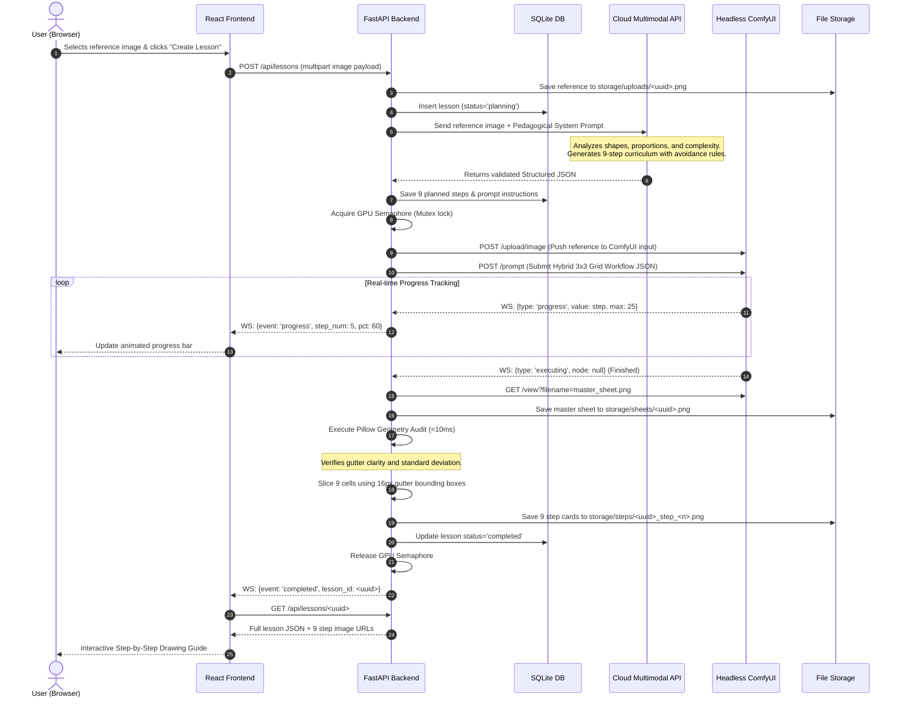

# SketchFlow AI — Final System Architecture

**Stage**: Stage 7 — Final Technical Architecture & Blueprint  
**Status**: APPROVED DESIGN (Consolidation of Stages 0–6)  
**Hardware Baseline**: Lenovo LOQ 15ARP9 (RTX 4050 6 GB VRAM, AMD Ryzen 7 7435HS, 24 GB RAM, Windows 11)  
**Document Path**: `docs/research/final_architecture.md`  

---

## 1. Executive System Overview

SketchFlow AI is a local-first, AI-powered drawing tutor designed to convert reference images into structured, beginner-friendly drawing lessons. The application teaches human learners how to draw by breaking subjects down into constructivist stages:
$$\text{Basic Gestures} \longrightarrow \text{Proportions/Volumes} \longrightarrow \text{Silhouette} \longrightarrow \text{Contour/Features} \longrightarrow \text{Line Detailing} \longrightarrow \text{Shading/Refinement}$$

The system operates on a **decoupled hybrid architecture**:
1. **Cognitive Tier (Cloud Multimodal API)**: Performs high-level visual deconstruction, anatomical analysis, and structured curriculum generation without consuming local GPU VRAM.
2. **Orchestration Tier (Local FastAPI Backend)**: Manages lesson state, SQLite relational persistence, job scheduling via an async GPU mutex, and deterministic Pillow image processing.
3. **Generative Tier (Headless Local ComfyUI)**: Runs strictly on loopback (`127.0.0.1:8188`) to execute diffusion workflows (SD 1.5 + ControlNet Lineart).
4. **Presentation Tier (React 19 + TypeScript + Vite + Tailwind CSS v4)**: An interactive, responsive web interface for step-by-step learning, zoom examination, and worksheet exports.

---

## 2. High-Level System Architecture Diagram

```mermaid
flowchart TD
    subgraph Client [Presentation Tier: Browser (Port 5173)]
        UI[React 19 + TypeScript SPA]
        Uploader[Image Uploader & Pre-crop]
        Viewer[Interactive Tutorial Card Viewer]
        Controls[Accept / Retry / Surgical Inpaint UI]
    end

    subgraph Backend [Orchestration Tier: FastAPI (Port 8000)]
        API[FastAPI Router & Endpoints]
        JobManager[Async Job Queue & GPU Mutex: asyncio.Semaphore(1)]
        PillowEngine[Pillow Image Processing & Grid Slicer]
        DB[(SQLite: lessons.db)]
        FS[(Local Storage: storage/)]
    end

    subgraph Cognitive [Cognitive Tier: Cloud API]
        CloudVLM[Multimodal LLM: Gemini 2.5 Flash]
        Planner[Curriculum Planning & Pydantic Schema]
    end

    subgraph Generative [Generative Engine: ComfyUI (Port 8188 Loopback)]
        ComfyServer[aiohttp REST & WebSocket]
        PromptQueue[ComfyUI Prompt Queue]
        SD15[Stable Diffusion 1.5 Lineart Pipeline]
        CNLineart[ControlNet v1.1 Lineart Engine]
        InpaintEngine[VAEEncodeForInpaint Engine]
    end

    %% Interactions
    Uploader -->|1. POST /api/lessons (Reference Image)| API
    API -->|2. Store Raw Image| FS
    API -->|3. Multimodal Analysis & Plan Request| CloudVLM
    CloudVLM -->|4. Structured Curriculum JSON| API
    API -->|5. Record Lesson in DB| DB
    API -->|6. Enqueue Generation Job| JobManager
    
    JobManager -->|7. Upload Image & Submit Workflow JSON| ComfyServer
    ComfyServer --> SD15
    CNLineart -.-> SD15
    InpaintEngine -.-> SD15
    
    ComfyServer <-->|8. WebSocket Telemetry: Node Progress| API
    API <-->|9. WebSocket Telemetry: Step % & Status| UI
    
    ComfyServer -->|10. GET /view Master Sheet PNG| API
    API -->|11. Slice 3x3 Cells with 16px Gutters| PillowEngine
    PillowEngine -->|12. Store Master Sheet & 9 Steps| FS
    API -->|13. Update Step Status to Ready| DB
    
    UI -->|14. Fetch Lesson & Stream Step Cards| API
    Controls -->|15. Single-Cell Repair Request| API
    API -->|16. Surgical Inpaint Workflow| InpaintEngine
```

---

## 3. Data Flow & Complete Lesson Lifecycle



---

## 4. Component Responsibility Matrix

| Component | Technology | Primary Responsibilities | Strict Boundaries |
| :--- | :--- | :--- | :--- |
| **Frontend UI** | React 19, TypeScript, Vite, Tailwind CSS v4 | - Display interactive drawing cards<br>- Step navigation (prev/next/slider)<br>- Full-screen drawing zoom<br>- Live WebSocket progress bar<br>- Trigger step retry or area correction | - **Zero AI logic** in frontend.<br>- No direct communication with ComfyUI.<br>- No API keys stored in client bundle. |
| **Backend API** | Python 3.11, FastAPI, Pydantic v2 | - REST endpoints (`/api/lessons`, `/api/health`)<br>- Duplex WebSocket broadcaster (`/api/ws`)<br>- Job orchestration with single-GPU mutex<br>- Validation of uploads (max 20MB, format) | - Does not render UI.<br>- Delegates model execution to ComfyUI. |
| **Cognitive Planner** | Cloud API (Gemini 2.5 Flash / Claude) | - Deconstruct reference image contours<br>- Determine visual complexity tier<br>- Generate 9 constructivist step prompts<br>- Enforce explicit `avoidance` rules per cell | - Pure text/JSON generation.<br>- Does not generate images. |
| **Image Generator** | Headless ComfyUI Core (Local) | - Load SD 1.5 checkpoint into GPU VRAM<br>- Condition cross-attention via ControlNet<br>- Execute 9-cell `ConditioningSetArea`<br>- Single-pass 25-step KSampler generation<br>- Execute inpainting repairs on demand | - Headless only; UI disabled.<br>- Bound strictly to loopback (`127.0.0.1:8188`).<br>- No external internet access. |
| **Image Processor** | Python Pillow (in FastAPI) | - Verify image header integrity<br>- Slice master grid into 9 discrete cells<br>- Remove 16px gutters to prevent bleeding<br>- Letterbox pad images without distortion<br>- Deterministic ESRGAN pixel upscaling | - Deterministic transformations only.<br>- Never alters semantic content. |
| **Persistence Store** | SQLite + Local Filesystem | - Relational tables for lessons, steps, prompts<br>- Store raw images, sheets, and steps<br>- Track user feedback and retry history | - Images never stored as database BLOBs. |

---

## 5. Clean Project Folder Structure

```
SketchFlowAI/
│
├── frontend/                         # Presentation Tier
│   ├── src/
│   │   ├── components/               # StatusBadge, StepCard, ProgressBar, CanvasViewer
│   │   ├── pages/                    # HomePage, LessonView, HistoryView
│   │   ├── services/                 # apiClient.ts, lessonService.ts, websocket.ts
│   │   ├── hooks/                    # useHealthCheck.ts, useLessonProgress.ts
│   │   ├── types/                    # api.ts, lesson.ts
│   │   ├── App.tsx
│   │   └── main.tsx
│   ├── package.json
│   └── vite.config.ts
│
├── backend/                          # Orchestration Tier
│   ├── app/
│   │   ├── api/
│   │   │   └── routes/               # health.py, lessons.py, websocket.py
│   │   ├── core/                     # config.py, security.py, database.py
│   │   ├── models/                   # Pydantic schemas & SQLAlchemy ORM models
│   │   ├── services/                 # comfy_client.py, planner_service.py, job_queue.py
│   │   ├── image_processing/         # validator.py, resizer.py, grid_processor.py, upscaler.py
│   │   └── main.py                   # FastAPI app factory, CORS, lifespan
│   ├── tests/                        # Backend unit & integration tests
│   ├── requirements.txt
│   └── .env                          # Local backend configuration (API keys, ports)
│
├── comfyui/                          # Generative Tier (Clean clone of ComfyUI Core)
│   ├── models/
│   │   ├── checkpoints/              # SD 1.5 lineart checkpoints (.safetensors)
│   │   ├── controlnet/               # ControlNet v1.1 lineart models (.safetensors)
│   │   └── upscale_models/           # ESRGAN x4 anime models (.pth / .safetensors)
│   ├── input/                        # Input directory for ComfyUI reference images
│   ├── output/                       # Temporary raw generation outputs
│   └── main.py                       # ComfyUI startup script
│
├── workflows/                        # Versioned Declarative ComfyUI API JSON Templates
│   ├── hybrid_3x3_grid.json          # Primary 3x3 generation workflow
│   ├── single_step_inpaint.json      # Surgical cell repair workflow
│   └── chained_step_img2img.json     # Single-step fallback workflow
│
├── storage/                          # Local Application Persistence (Excluded from Git)
│   ├── uploads/                      # Raw user reference uploads
│   ├── sheets/                       # 1024x1024 Master 3x3 generation sheets
│   ├── steps/                        # Extracted 320x320 individual step cards
│   ├── exports/                      # User-downloaded compiled worksheets (PDF/ZIP)
│   └── sketchflow.db                 # SQLite relational database file
│
├── docs/                             # Documentation & Stage Reports
│   └── research/                     # Comprehensive Stage 0–7 Markdown reports
│
├── scripts/                          # Automated Developer & Operational Utilities
│   ├── start_comfyui.bat             # Starts headless ComfyUI with optimal VRAM flags
│   ├── start_backend.bat             # Starts FastAPI uvicorn server
│   └── start_frontend.bat            # Starts Vite dev server
│
├── .gitignore                        # Strict rules excluding models, venvs, and storage
└── README.md                         # Project setup and running instructions
```

---

## 6. Storage Budget & Disk Space Plan (512 GB SSD)

On our target Lenovo LOQ laptop, Drive `D:\` has **240.85 GB free**. Below is the strictly capped disk allocation budget:

| Component | Target Directory | Storage Allocation | Required? | Management Policy |
| :--- | :--- | :---: | :---: | :--- |
| **ComfyUI Core + PyTorch Environment** | `comfyui/` & `.venv/` | $\approx 5.5\text{ GB}$ | Yes | Fixed installation footprint. |
| **SD 1.5 Lineart Checkpoint** | `comfyui/models/checkpoints/` | $\approx 2.1\text{ GB}$ | Yes | Single pruned `.safetensors` model. |
| **ControlNet Lineart v1.1** | `comfyui/models/controlnet/` | $\approx 1.4\text{ GB}$ | Yes | Single FP16 `.safetensors` model. |
| **ESRGAN Anime Upscaler** | `comfyui/models/upscale_models/` | $\approx 0.07\text{ GB}$ | Optional | Single `.pth` model file (65 MB). |
| **Node.js & Frontend Build** | `frontend/node_modules/` | $\approx 0.35\text{ GB}$ | Yes | Standard npm dependencies. |
| **Application Python Backend** | `backend/.venv/` | $\approx 0.45\text{ GB}$ | Yes | FastAPI, Pillow, Pydantic, SQLAlchemy. |
| **Lesson Storage (100 Lessons)** | `storage/` (`uploads`, `sheets`, `steps`) | $\approx 1.5\text{ GB}$ | Dynamic | $15\text{ MB}$ per lesson (Master sheet + 9 crops). |
| **ComfyUI Temp Cache** | `comfyui/output/` | $\approx 2.0\text{ GB}$ max | Dynamic | Auto-pruned on backend startup. |
| **Total SketchFlow Footprint** | | **$\approx 13.5\text{ GB}$** | | **Leaves $>225\text{ GB}$ safety buffer on Drive D:** |

---

## 7. Security and Privacy Architecture

1. **Local-First Isolation**:
   - ComfyUI is bound strictly to `127.0.0.1` via `--listen 127.0.0.1 --port 8188`.
   - Port 8188 is blocked from external networks by the Windows Firewall.
   - The end user communicates exclusively through FastAPI (`127.0.0.1:8000`).
2. **Cloud API Boundary & Secret Protection**:
   - The Cloud Multimodal API key (`GEMINI_API_KEY`) is stored exclusively in `backend/.env` and is never sent to the browser.
   - **What leaves the laptop**: Only the user's reference image and prompt instructions are sent over encrypted HTTPS to the vision API for curriculum planning.
   - **What stays local**: All generated drawing sheets, extracted steps, intermediate latents, user progress, and feedback are generated and stored 100% locally.
3. **Malicious File & Upload Safeguards**:
   - Uploaded files are verified via Pillow binary header parsing (`Image.verify()`); non-image files are rejected immediately.
   - Strict size limit: 20 MB max per upload.
   - Only `.safetensors` model formats are permitted; legacy unpickled `.ckpt` files are forbidden.
4. **Single-GPU Mutex Guard (`asyncio.Semaphore(1)`)**:
   - Protects against CUDA Out-of-Memory crashes. If a user triggers a regeneration while another lesson is rendering, the job is queued in SQLite rather than overwhelming the 6 GB VRAM.
