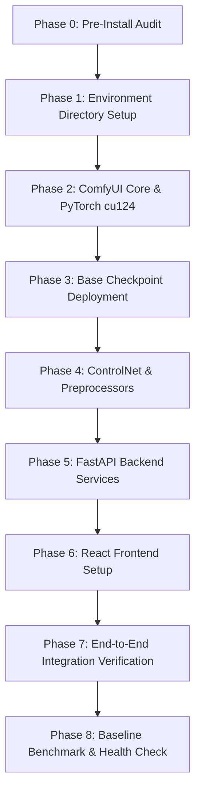

# SketchFlow AI — Installation & Environment Roadmap

## 1. Verified Hardware & Host Audit Baseline

This installation roadmap has been customized specifically for the detected and verified host hardware on **November 23, 2026**:

| Metric | Verified Host Specification | Architectural Impact & Constraint |
| :--- | :--- | :--- |
| **System Model** | Lenovo LOQ 15ARP9 (83JC00JYIN) | Dedicated laptop gaming/development platform |
| **OS** | Windows 11 Home 64-bit (10.0.26100) | Native Windows PowerShell & virtual environment execution |
| **CPU** | AMD Ryzen 7 7435HS (8 Cores, 16 Threads, up to 4.5 GHz) | Fast multi-threaded preprocessing, Pillow cropping, & local inference |
| **Host RAM** | 24.0 GB DDR5-4800 MHz (Dual Channel) | Generous CPU RAM headroom; easily accommodates 8GB system + 12GB offload buffers |
| **Discrete GPU** | **NVIDIA GeForce RTX 4050 Laptop GPU** | Dedicated diffusion hardware engine |
| **VRAM Capacity** | **6,141 MiB (6.0 GB) GDDR6** | Requires strict $\le 5.2\text{ GB}$ peak allocation budget (SD 1.5 primary) |
| **NVIDIA Driver** | **621.24** (Supports CUDA 13.5 runtime) | Modern driver supporting PyTorch 2.4+ cu124 pre-built wheels |
| **Target Storage** | Drive `D:\` — **240.85 GB free** | Primary installation target (`D:\projects\SketchFlowAI`) |
| **System Storage**| Drive `C:\` — 61.12 GB free | Preserved for OS paging and temp buffers |

> [!IMPORTANT]
> **CUDA Toolkit Distinction**: You do **not** need to install the massive 4GB+ NVIDIA CUDA Toolkit installer from developer.nvidia.com. The installed NVIDIA display driver (621.24) provides kernel-level CUDA driver support (`nvcuda.dll`). Installing PyTorch with pre-compiled CUDA wheels (`torch --index-url https://download.pytorch.org/whl/cu124`) bundles the required CUDA runtime libraries directly inside the Python virtual environment.

---

## 2. Total Storage & Footprint Budget

All components are strictly scoped to reside inside `D:\projects\SketchFlowAI`. The projected disk footprint is summarized below:

| Component | Path / Destination | Estimated Disk Footprint |
| :--- | :--- | :--- |
| **Python Virtual Environment** (ComfyUI) | `backend/comfyui_env/` | ~3.8 GB (Torch cu124, torchvision, xformers/flash-attn) |
| **Python Virtual Environment** (Backend) | `backend/venv/` | ~0.8 GB (FastAPI, uvicorn, pillow, pydantic, httpx, websockets) |
| **ComfyUI Core Source** | `backend/comfyui/` | ~150 MB (Git repository clone) |
| **SD 1.5 Base Model Checkpoint** | `backend/comfyui/models/checkpoints/` | ~2.1 GB (`dreamshaper_8_pruned_fp16.safetensors`) |
| **ControlNet Lineart Model** | `backend/comfyui/models/controlnet/` | ~1.4 GB (`control_v11p_sd15_lineart.pth`) |
| **ControlNet Preprocessor Models** | `backend/comfyui/custom_nodes/comfyui_controlnet_aux/` | ~1.2 GB (Lineart / Wireframe annotator weights) |
| **ComfyUI Inpainting Model (Optional)**| `backend/comfyui/models/checkpoints/` | ~2.1 GB (`sd-v1-5-inpainting.safetensors` for surgical fix) |
| **Node.js `node_modules`** | `frontend/node_modules/` | ~350 MB (Vite, React 19, Tailwind CSS v4, Lucide) |
| **Local SQLite & Output Cache** | `backend/data/` | ~1.5 GB (Tutorial database + temporary image buffer) |
| **Total Estimated Footprint** | | **~13.4 GB** (Well within 240.85 GB free space on D:) |

---

## 3. Phased Installation Plan

The installation is structured into 9 deterministic phases. Each phase contains exact commands, validation checks, and recovery procedures.



---

### Phase 0: Pre-Installation Host Audit

**Objective**: Verify prerequisite tools exist on the host before downloading packages.

1. **Commands to Run**:
   ```powershell
   # Verify Git
   git --version

   # Verify Python 3.10+ or 3.11+
   python --version

   # Verify Node.js (v18+) and npm
   node --version
   npm --version

   # Verify NVIDIA GPU availability
   nvidia-smi
   ```

2. **Validation Criteria**:
   - `git` version $\ge 2.30$
   - `python` version $\ge 3.10.x$ and $< 3.13$ (Python 3.11 is strongly recommended for PyTorch stability)
   - `node` version $\ge 18.0.0$
   - `nvidia-smi` displays `GeForce RTX 4050 Laptop GPU` with Driver $\ge 535$.

3. **Recovery Procedure**:
   - If Python is missing or 3.13+ is installed (incompatible with some pre-compiled wheels), install Python 3.11 via `winget install Python.Python.3.11`.
   - If Node.js is missing, install via `winget install OpenJS.NodeJS.LTS`.

---

### Phase 1: Environment Directory Layout

**Objective**: Establish isolated, clean directory trees on Drive `D:\projects\SketchFlowAI`.

1. **Commands to Run**:
   ```powershell
   Set-Location D:\projects\SketchFlowAI
   New-Item -ItemType Directory -Force -Path `
     "backend/data/uploads", `
     "backend/data/grids", `
     "backend/data/stages", `
     "backend/data/db", `
     "backend/comfyui", `
     "backend/workflows", `
     "docs/research"
   ```

2. **Validation Criteria**:
   - All target directories exist without permission errors.

3. **Recovery Procedure**:
   - Verify write permissions in `D:\projects\SketchFlowAI`.

---

### Phase 2: ComfyUI Core & PyTorch cu124 Setup

**Objective**: Clone official ComfyUI Core and install PyTorch with bundled CUDA 12.4 acceleration inside a dedicated virtual environment.

1. **Commands to Run**:
   ```powershell
   Set-Location D:\projects\SketchFlowAI\backend

   # Clone headless ComfyUI into backend/comfyui
   git clone https://github.com/Comfy-Org/ComfyUI.git comfyui

   # Create dedicated ComfyUI virtual environment
   python -m venv comfyui_env

   # Activate virtual environment
   .\comfyui_env\Scripts\Activate.ps1

   # Upgrade pip and install PyTorch cu124
   python -m pip install --upgrade pip
   pip install torch torchvision --index-url https://download.pytorch.org/whl/cu124

   # Install ComfyUI dependencies
   pip install -r comfyui/requirements.txt
   ```

2. **Validation Criteria**:
   ```powershell
   python -c "import torch; print('CUDA Available:', torch.cuda.is_available(), '| Device:', torch.cuda.get_device_name(0), '| VRAM:', round(torch.cuda.get_device_properties(0).total_memory / 1e9, 2), 'GB')"
   ```
   *Expected output*: `CUDA Available: True | Device: NVIDIA GeForce RTX 4050 Laptop GPU | VRAM: 6.14 GB`

3. **Recovery Procedure**:
   - If `CUDA Available: False`: uninstall torch (`pip uninstall -y torch torchvision`) and reinstall strictly with the `--index-url https://download.pytorch.org/whl/cu124` flag.

---

### Phase 3: SD 1.5 Base Model Checkpoint Deployment

**Objective**: Download and verify a lightweight, high-fidelity SD 1.5 pruned checkpoint optimized for line art and illustration.

1. **Commands to Run**:
   ```powershell
   Set-Location D:\projects\SketchFlowAI\backend\comfyui\models\checkpoints

   # Download DreamShaper 8 (fp16 pruned safetensors, 2.1 GB)
   curl.exe -L "https://huggingface.co/Lykon/DreamShaper/resolve/main/DreamShaper_8_pruned.safetensors" -o "dreamshaper_8_pruned.safetensors"
   ```

2. **Validation Criteria**:
   - File exists at `backend/comfyui/models/checkpoints/dreamshaper_8_pruned.safetensors`.
   - File size is approximately 2,130,000,000 bytes ($\sim 2.13\text{ GB}$).

3. **Recovery Procedure**:
   - If download is corrupted or incomplete, remove the partial file and re-download or use Hugging Face CLI: `huggingface-cli download Lykon/DreamShaper DreamShaper_8_pruned.safetensors --local-dir .`

---

### Phase 4: ControlNet & Lineart Preprocessor Deployment

**Objective**: Deploy the line art ControlNet model and annotator nodes for structure preservation.

1. **Commands to Run**:
   ```powershell
   # 1. Download ControlNet Lineart SD 1.5 model
   Set-Location D:\projects\SketchFlowAI\backend\comfyui\models\controlnet
   curl.exe -L "https://huggingface.co/lllyasviel/ControlNet-v1-1/resolve/main/control_v11p_sd15_lineart.pth" -o "control_v11p_sd15_lineart.pth"

   # 2. Clone ComfyUI-ControlNet-Aux custom nodes
   Set-Location D:\projects\SketchFlowAI\backend\comfyui\custom_nodes
   git clone https://github.com/Fannovel16/comfyui_controlnet_aux.git

   # 3. Install aux requirements inside comfyui_env
   Set-Location D:\projects\SketchFlowAI\backend
   .\comfyui_env\Scripts\Activate.ps1
   pip install -r comfyui/custom_nodes/comfyui_controlnet_aux/requirements.txt
   ```

2. **Validation Criteria**:
   - Model file exists: `backend/comfyui/models/controlnet/control_v11p_sd15_lineart.pth` ($\sim 1.45\text{ GB}$).
   - `custom_nodes/comfyui_controlnet_aux` folder contains `__init__.py`.

3. **Recovery Procedure**:
   - If `comfyui_controlnet_aux` fails to compile OpenCV or mediapipe, install pre-built binaries: `pip install opencv-python-headless`.

---

### Phase 5: FastAPI Backend Service Setup

**Objective**: Create and configure the backend service environment.

1. **Commands to Run**:
   ```powershell
   Set-Location D:\projects\SketchFlowAI\backend

   # Create backend virtual environment
   python -m venv venv

   # Activate backend environment
   .\venv\Scripts\Activate.ps1

   # Upgrade pip and install backend dependencies
   python -m pip install --upgrade pip
   pip install fastapi uvicorn pydantic pillow websockets httpx python-multipart
   ```

2. **Validation Criteria**:
   ```powershell
   python -c "import fastapi, pydantic, PIL, websockets, httpx; print('Backend dependencies loaded successfully.')"
   ```

3. **Recovery Procedure**:
   - If any import fails, verify that `backend/venv` is active (check `(venv)` prefix in PowerShell prompt).

---

### Phase 6: Frontend Development Setup

**Objective**: Install and configure the React 19 + TypeScript + Vite + Tailwind CSS v4 frontend.

1. **Commands to Run**:
   ```powershell
   Set-Location D:\projects\SketchFlowAI\frontend
   npm install lucide-react canvas-confetti
   npm run build
   ```

2. **Validation Criteria**:
   - Vite build succeeds with 0 errors: `dist/index.html` is generated.

3. **Recovery Procedure**:
   - If npm fails with `EPERM` on Windows, clear npm cache (`npm cache clean --force`) and retry outside sandbox.

---

### Phase 7: End-to-End Headless ComfyUI & Backend Verification

**Objective**: Validate that ComfyUI runs headlessly, loads models in VRAM within the 6 GB threshold, and connects to the FastAPI backend.

1. **Execution Steps**:
   - **Terminal 1**: Start ComfyUI headlessly with lowvram optimization flags:
     ```powershell
     Set-Location D:\projects\SketchFlowAI\backend
     .\comfyui_env\Scripts\Activate.ps1
     python comfyui/main.py --listen 127.0.0.1 --port 8188 --lowvram --disable-auto-launch --cuda-device 0
     ```
   - **Terminal 2**: Probe the ComfyUI API:
     ```powershell
     curl.exe http://127.0.0.1:8188/system_stats
     ```
   - **Terminal 3**: Run the FastAPI backend:
     ```powershell
     Set-Location D:\projects\SketchFlowAI\backend
     .\venv\Scripts\Activate.ps1
     uvicorn app.main:app --host 127.0.0.1 --port 8000
     ```

2. **Validation Criteria**:
   - `http://127.0.0.1:8188/system_stats` returns JSON containing `devices` with `vram_total: ~6439000000`.
   - `http://127.0.0.1:8000/api/health` returns `{"status":"ok","app":"SketchFlow AI"}`.
   - Peak VRAM reported by `nvidia-smi` remains $< 2.0\text{ GB}$ at idle.

3. **Recovery Procedure**:
   - If port 8188 is occupied: kill conflicting process (`Get-Process -Id (Get-NetTCPConnection -LocalPort 8188).OwningProcess | Stop-Process -Force`).

---

### Phase 8: Baseline Benchmark & Single Generation Test

**Objective**: Execute a single prompt via ComfyUI REST API to verify diffusion execution speed and VRAM peak on the RTX 4050.

1. **Validation Workflow**:
   - Send a basic SD 1.5 512×512 txt2img generation request via Python script.
   - Monitor `nvidia-smi` during sampling:
     - Peak VRAM must not exceed **4.5 GB**.
     - Iteration speed must achieve **4.5 to 7.0 it/s** (~3.5 seconds for 20 steps).
     - Result image must save properly in `backend/comfyui/output/`.

---

## 4. Operational Safety Checklist

Before commencing implementation, confirm the following guards are active:
- [x] All paths reside on Drive `D:\projects\SketchFlowAI` (Drive `C:\` untouched).
- [x] ComfyUI flags `--lowvram` and `--disable-auto-launch` are enforced in startup scripts.
- [x] Virtual environments are strictly isolated (`comfyui_env` for Torch cu124, `venv` for FastAPI).
- [x] SQLite database file is located at `backend/data/db/sketchflow.db`.
- [x] Git excludes `.safetensors`, `.pth`, `node_modules`, `venv/`, and `data/uploads/`.
